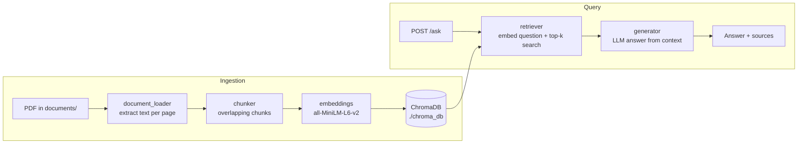

# Ask My Documents

A retrieval-augmented generation (RAG) API for asking questions about your own PDF documents. PDFs are split into chunks, embedded with sentence-transformers, and stored in a local ChromaDB collection. At query time the most relevant chunks are retrieved and passed to a language model, which answers using only that context and cites its sources.

## Architecture



| Module | Responsibility |
| --- | --- |
| `app/document_loader.py` | Reads a PDF with `pypdf` and returns the text of each non-empty page with its page number and file name. |
| `app/chunker.py` | Splits page text into overlapping word-based chunks. |
| `app/embeddings.py` | Wraps a `SentenceTransformer` model to embed documents and queries (normalized vectors). |
| `app/vector_store.py` | Persistent ChromaDB collection (cosine distance) for upserting and querying chunks. |
| `app/retriever.py` | Embeds a question and returns the top-k matching chunks with source, page and distance. |
| `app/generator.py` | Builds a grounded prompt from the retrieved chunks and generates an answer. |
| `app/main.py` | FastAPI application exposing the `/ask` endpoint. |
| `ingestion.py` | Script that loads a PDF, chunks it, embeds the chunks and stores them in ChromaDB. |

## Tech stack

- Python
- FastAPI and Pydantic
- ChromaDB (persistent local vector store)
- sentence-transformers (`all-MiniLM-L6-v2`)
- pypdf
- Ollama (local LLM for answer generation, default model `qwen3:4b`)

## Setup

1. Clone the repository and create a virtual environment:

   ```bash
   git clone https://github.com/ZeeshanRQ/ask-my-documents.git
   cd ask-my-documents
   python -m venv venv
   source venv/bin/activate      # Windows: venv\Scripts\activate
   ```

2. Install dependencies:

   ```bash
   pip install -r requirements.txt
   ```

3. (Optional) Create a `.env` file from the template:

   ```bash
   cp .env.example .env
   ```

4. Install [Ollama](https://ollama.com) and pull the default model:

   ```bash
   ollama pull qwen3:4b
   ```

## Usage

### 1. Ingest documents

Place a PDF in `documents/` and run the ingestion script from the project root. The script reads the path set in its `__main__` block (`documents/sample_company_policy.pdf` by default); update it to point at your own file:

```bash
python ingestion.py
```

Chunks are stored in `./chroma_db`.

### 2. Start the API

```bash
uvicorn app.main:app --reload
```

Interactive docs are available at `http://127.0.0.1:8000/docs`.

### 3. Ask a question

`POST /ask`

| Field | Type | Rules |
| --- | --- | --- |
| `question` | string | required, 3 to 1000 characters |
| `top_k` | integer | optional, 1 to 10, default 4 |

```bash
curl -X POST http://127.0.0.1:8000/ask \
  -H "Content-Type: application/json" \
  -d '{"question": "How many days of annual leave do employees get?", "top_k": 3}'
```

Response shape:

```json
{
  "answer": "string",
  "sources": [
    {
      "source": "sample_company_policy.pdf",
      "page": 1,
      "distance": 0.0,
      "text": "string"
    }
  ]
}
```

Error responses:

- `404` if no relevant chunks are found
- `500` if the question cannot be processed (the `detail` field contains the error)

## Project structure

```
ask-my-documents/
├── app/
│   ├── __init__.py
│   ├── chunker.py
│   ├── config.py
│   ├── document_loader.py
│   ├── embeddings.py
│   ├── generator.py
│   ├── main.py
│   ├── retriever.py
│   └── vector_store.py
├── documents/
│   └── sample_company_policy.pdf
├── ingestion.py
├── requirements.txt
├── .env.example
└── .gitignore
```
